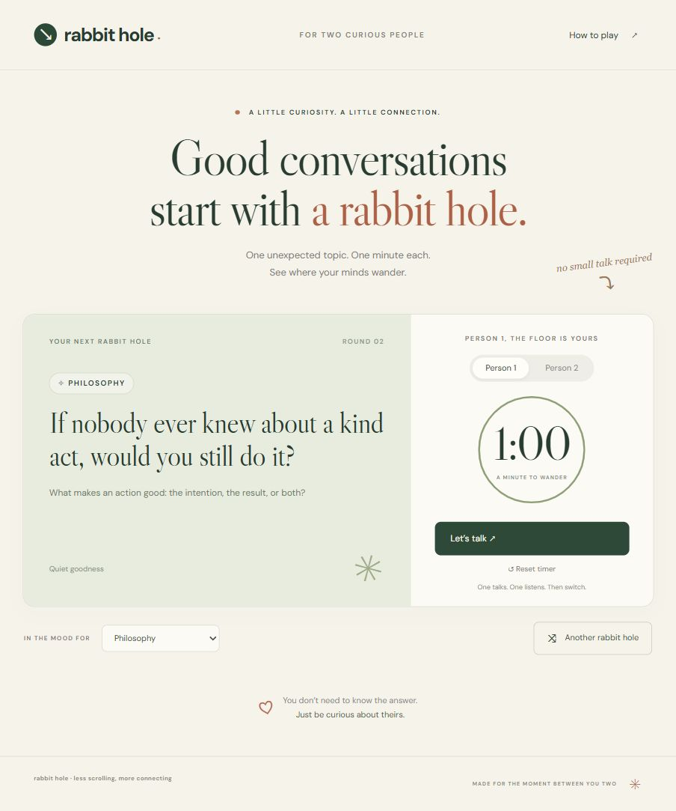

<div align="center">

# rabbit hole ↘

### One screen. Two people. Absolutely no idea where this conversation is going.

**Random topics. One minute each. A date that accidentally turns into a debate about free will.**

[Try Rabbit Hole](https://rabbit-hole-date.sassycabin.chatgpt.site) · [Run it locally](#get-it-running) · [Add a rabbit hole](#got-a-better-question)


<br>



</div>

## Okay, but what is this?

You sit across from someone. You want to talk. Your brain offers:

> “So… aur batao?”

Great. Incredible work, brain.

Rabbit Hole gives you something better. A question from space, psychology, literature, maths, politics, food, or whatever the shuffle throws at you. One person talks for a minute. The other actually listens. Then you switch.

Maybe you disagree about time travel. Maybe a question about chemistry turns into a childhood memory. Maybe you learn something about the person sitting right there.

That's the whole idea. Thoda curiosity. Thoda connection.

## The date goes like this

1. Put one screen between you two.
2. Choose **Anything**, or pick a subject you're in the mood for.
3. Read the question. Knowing the answer is optional. Having a thought is enough.
4. Hit **Let's talk**. Person 1 gets 60 seconds.
5. When time is up, hand over the conversation. Person 2 starts their own minute when ready.
6. Keep talking if it gets good. Shuffle if you want another rabbit hole.

The timer is a nudge. Please don't interrupt a beautiful story because a circle hit zero.

## Pick your kind of chaos

**Space · Physics · Chemistry · Maths · Computer science · History · Geography · Politics · Psychology · Philosophy · Literature · Art · Music · Nature · Food · Everyday life**

A few questions waiting inside:

> If the universe is infinite, is there another version of us having this date?

> Is falling in love just chemistry?

> Which meal feels like home to you?

> If nobody ever knew about a kind act, would you still do it?

One minute ago you were choosing dinner. Now you're defending your entire moral framework. Happens.

## What works today

- 32 curated prompts across 16 subjects.
- Random shuffle without immediately repeating the current prompt.
- Separate one minute turns, with pause, resume, and reset.
- A fresh first turn when you change the topic.
- A layout that stacks on smaller screens.
- Keyboard controls, visible focus states, and screen reader announcements at turn changes.
- Conversation stays in the room. The app does not record your answers.

The topic bank is finite. The conversations hopefully aren't.

The hosted version currently requires ChatGPT sign in and is private to its owner. This GitHub repository is public, and the local version runs without a login.

## Get it running

You'll need **Node.js 22 or newer** and npm.

```sh
git clone https://github.com/TheRealSaiTama/rabbithole.git
cd rabbithole
npm ci
npm run dev
```

Open **http://localhost:3000**. Grab another human. That's the setup.

No API keys. No database. No environment variables to hunt down.

## Under the hood

Plain HTML, CSS, and JavaScript modules. Node's HTTP server handles the local preview. The app itself runs in the browser.

```text
dist/
  index.html       the page
  style.css        the look
  app.mjs          turns, timer, and controls
  topics.mjs       questions and topic selection
assets/
  preview.png      README screenshot
tests/
  topics.test.mjs  topic selection and timer checks
server.mjs        local preview server
```

ESLint checks JavaScript. Prettier handles formatting with two space indentation and single quotes. Variables and functions use camelCase. Code has no comments.

Google Fonts supplies DM Sans and Libre Caslon Display. Fallback fonts keep the page usable when those fonts cannot load.

## Before you push

```sh
npm run lint
npm test
npm run build
```

To format your changes:

```sh
npm run format
```

Tests use Node's built in test runner. They check that every subject can select a different prompt and that delayed timer ticks stop at zero.

There is no bundling step. `npm run build` checks the browser entry point's syntax. Serve the contents of `dist/` with any static host. `server.mjs` is for local development.

## Got a better question?

Add it to `dist/topics.mjs` using the existing shape:

```js
[
  'Philosophy',
  'Would you rather be understood or admired?',
  'Think of a moment when the difference mattered to you.',
  'Being seen',
];
```

Keep it open enough for two different answers. Give people a way into it. Trivia has its place; this is a conversation.

New subjects show up in the picker automatically. Keep at least two prompts per subject so shuffling has somewhere else to go. Run the checks before sending a PR.

---

<div align="center">

**Less “aur batao.” More “wait, you think that too?”**

Built by [TheRealSaiTama](https://github.com/TheRealSaiTama). Bring your own curiosity.

</div>
